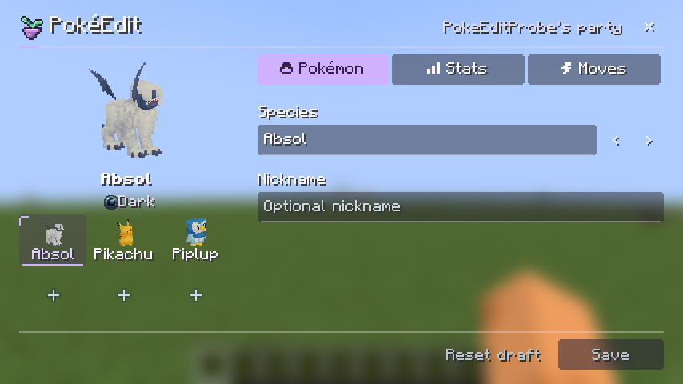
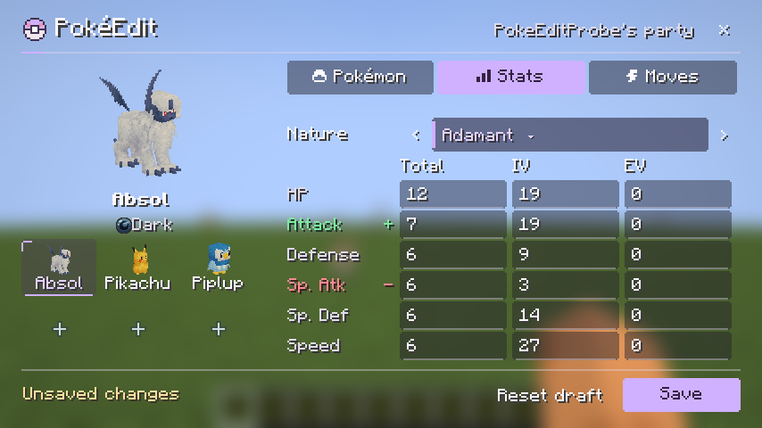
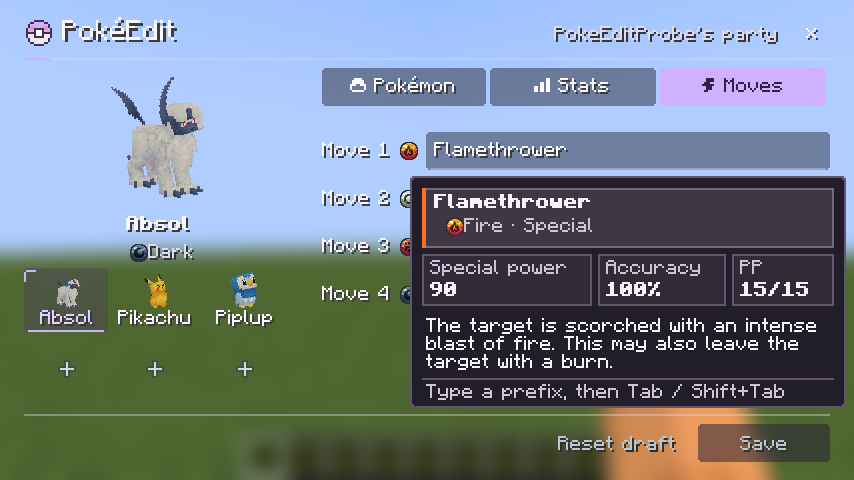

<div align="center">


<h1>PokéEdit</h1>
<p><strong>A party and stat editor for Cobblemon</strong></p>
<p>Minecraft 1.21.1 · Fabric · Cobblemon 1.7.3 · Java 21</p>
<p><a href="https://github.com/MCTEEKUNG/PokeEdit/releases/download/v1.2.15/cobblemon-stat-editor-1.2.15.jar"><strong>Download PokéEdit 1.2.15 (.jar)</strong></a> · <a href="https://github.com/MCTEEKUNG/PokeEdit/releases">All releases</a> · <a href="#installation">Installation</a></p>

</div>



Open any of your six party slots to edit a Pokémon or add one to an empty slot. Pick a species, set its nature, build a moveset, and fine-tune its stats while you preview the Pokémon in 3D.

## Installation

1. Use Minecraft Java Edition **1.21.1** with **Java 21** and **Fabric Loader 0.17.2 or later**. [Fabric installer](https://fabricmc.net/use/installer/)
2. Install **Fabric API 0.116.6 or later** for Minecraft 1.21.1 and **Cobblemon 1.7.3** for Fabric. [Fabric API](https://modrinth.com/mod/fabric-api/versions?g=1.21.1) · [Cobblemon 1.7.3](https://modrinth.com/mod/cobblemon/version/kF7CvxTo)
3. Download the PokéEdit JAR and place it in your instance’s `mods` folder. Replace any older PokéEdit or Cobblemon Stat Editor JAR when you update. [Latest release](https://github.com/MCTEEKUNG/PokeEdit/releases/latest)
4. Start Minecraft and press **K**, or run `/stat ui`, to open your party.

For multiplayer, install the same PokéEdit version on the **server** and each **client that uses the editor**. See the migration notes if you already use Party Manager. [Server and migration reference](docs/pokeedit-reference.md#upgrading)

## Edit a party

| Tab | What you can change |
| --- | --- |
| **Pokémon** · **Ctrl+1** | Rename a Pokémon, change its species, or add a level 1 Pokémon to an empty slot. **Tab** and **Shift+Tab** browse species alphabetically. |
| **Stats** · **Ctrl+2** | Edit effective stats, IVs, and EVs. Search for a nature by name or stat. Green **+** marks the stat it raises and red **−** marks the stat it lowers. |
| **Moves** · **Ctrl+3** | Type a move name or ID. Type a prefix and use **Tab** or **Shift+Tab** to cycle through matches. Hover a move to see its type, category, power, accuracy, PP, and effect. |

Apply your changes with **Save** or **Ctrl+S**. Use **Reset draft** to discard changes to the current slot.

<table>
  <tr>
    <td width="50%"><a href="docs/pokeedit-stats.png"></a></td>
    <td width="50%"><a href="docs/pokeedit-move-details.png"></a></td>
  </tr>
</table>

The editor adapts when the window is narrow. [Compact layout](docs/pokeedit-party-compact.png)

### PokéEdit Staff

Find the staff in **Creative → Tools**, or use `/stat give <player>` if you have admin permission. Right-click to open your party. Admins can aim at a visible player within interaction range and right-click to open that player’s party. A cycling rainbow outline marks the target. [Staff preview](docs/pokeedit-master-wand.png)

### Live stat editing

Run `/stat live` to edit effective stats with number fields and step buttons. Direct stat edits take effect in Cobblemon’s built-in battle simulator, including during battle. Pokémon keep their stat bonuses through leveling, evolution, trading, and PC storage. For example, if you raise HP from 20 to 100, PokéEdit stores an 80-point bonus. When natural HP grows to 22, edited HP rises to 102. [Battle behavior and limits](docs/pokeedit-reference.md#effective-stats)

| Command | Action |
| --- | --- |
| `/stat view 1` | Show the first party member’s current and natural stats. |
| `/stat set 1 hp 250 atk 300` | Set the first party member’s HP and Attack. |
| `/stat reset 1` | Restore the first party member’s natural stats. |

[All commands and server settings](docs/pokeedit-reference.md)

## Build from source

With **JDK 21** selected, build and run the tests with the Gradle wrapper.

```bash
./gradlew build
```

The mod JAR is written to `build/libs/`. [Build and test reference](docs/pokeedit-reference.md#build-and-verify)

[Report an issue](https://github.com/MCTEEKUNG/PokeEdit/issues)
